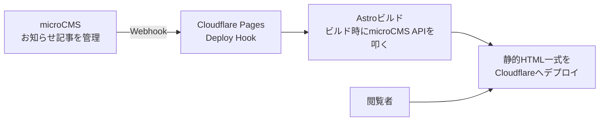

## はじめに

石鹸ブランドのコーポレートサイト（LP + お知らせ機能）を、Astro + microCMS + Cloudflare Pages という構成で構築しました。この記事では、なぜこの構成を選んだのか、そして実際に運用してみて月額いくらかかるのか（あるいはかからないのか）を、他の選択肢と比較しながらまとめます。

「小規模ブランドサイトを立ち上げたいが、月額コストはできるだけ抑えたい」という個人開発者・小規模事業者の参考になれば幸いです。

## 背景・要件

今回のサイトは以下の2フェーズで計画しています。

- **フェーズ1（今回）**：ブランドのLP・About・お知らせ（ニュース）発信のみ。ECのカート・決済機能は持たない
- **フェーズ2（将来）**：オンラインストア機能を追加。カート・決済まわりは自前実装せず、STORESやShopifyのような既存ECサービスに乗せる想定

つまりフェーズ1の役割は「ブランドの世界観とお知らせを届けるコンテンツサイト」に限定されています。フェーズ2でどのECサービスを選ぶかは別途検討するとして、まずはこの前提のもとでフェーズ1の技術選定を振り返ります。

## アーキテクチャ

構成はシンプルです。

ポイントは、**ページはすべて静的生成（SSG）で、動的なサーバー処理を持たない**ことです。

- Astroの `output: 'static'` で全ページを静的HTMLとしてビルド
- お知らせ記事だけはビルド時にmicroCMSのAPIを叩いて取得（実行時にはAPIを呼ばない）
- microCMSで記事を公開・更新すると、Webhook経由でCloudflare PagesのDeploy Hookが叩かれ、自動で再ビルド・再デプロイされる

Cloudflare Workers用のアダプターは使っていません。動的なサーバーサイド処理（SSR、API Routesなど）が一切不要な構成だからです。この「アダプター不要」という点が、後述のコスト構造にも直結します。

## なぜAstroか

Next.jsやNuxtも候補に挙がりましたが、Astroを選んだ理由は次の2点です。

1. **フェーズ1に必要なのは静的サイトだけ**：認証もフォーム送信もない、コンテンツ配信オンリーのサイトなので、React/Vueのハイドレーションやサーバーランタイムはオーバースペックでした
2. **JSはデフォルトでゼロ配信**：Astroはコンポーネントをビルド時にHTMLへ変換し、必要な箇所だけ明示的にJSを注入する設計（Islands Architecture）。今回は表示が中心のサイトなので、ページのJS配信量を実質ゼロに抑えられます

フェーズ2でECのフロント側に多少のインタラクション（カートUIなど）が必要になっても、Astro Islandsで部分的にReact/Vueコンポーネントを差し込めるため、フェーズ1の構成を壊さずに拡張できる点も決め手でした。

## なぜmicroCMSか

ヘッドレスCMSはmicroCMS、WordPress（ヘッドレス構成）、Contentfulなどが候補でした。

- **WordPress**：サーバー運用（ホスティング、セキュリティアップデート）のコストと手間が発生する。今回は「サーバーを持たない」構成にしたかったため見送り
- **Contentful**：海外サービスで管理画面が英語中心。運用担当者（非エンジニア）が記事を更新する想定だったため、日本語UIのmicroCMSを優先
- **microCMS**：国産、管理画面が日本語、無料プランでも今回の記事数・API数には十分

「お知らせ記事を管理画面から更新するだけ」というシンプルな用途に対して、運用担当者が迷わず使えることを最優先にmicroCMSを選びました。

## コスト比較

ここが本題です。フェーズ1構成の実際の費用感を、選択肢ごとに整理します。

### Cloudflare Pagesの料金

Cloudflare Pagesの無料プランには以下の制限があります。

| 項目 | Freeプラン | Proプラン（Workers Paid, $5〜） |
|---|---|---|
| 月間ビルド回数 | 500回 | 5,000回 |
| 同時ビルド数 | 1件 | 5件 |
| ファイル数上限 | 20,000ファイル | 100,000ファイル |
| 単一ファイルサイズ上限 | 25MiB | 25MiB |
| カスタムドメイン数 | 100個 | 250個 |
| 帯域幅・リクエスト数 | 無制限 | 無制限 |

静的サイトのホスティング自体（帯域幅・リクエスト数）はFreeプランでも無制限です。今回の構成で注意すべきはむしろ**月間ビルド回数の上限（500回）**です。今回のサイトは「記事を保存するたびに自動リビルド」という設計なので、お知らせを1日十数件ペースで更新するような運用になると、月500回の上限に近づく可能性があります。フェーズ1の更新頻度（月数件〜十数件程度）であれば問題になりませんが、更新が頻繁になる場合は頭に入れておくとよいでしょう。

### microCMSの料金

| プラン | 月額 | API数 | コンテンツ数 | データ転送量 |
|---|---|---|---|---|
| 無料（Hobby） | 0円 | 5個 | 10,000件 | 20GB/月 |
| Team | 4,900円〜 | 10個 | 20,000件 | 200GB/月 |
| Business | 75,000円〜 | 30個 | 50,000件 | 1TB/月 |

今回使うAPIは「news」の1つのみ、記事数も数十〜数百件規模なので、無料プランの上限（API5個・コンテンツ1万件）には全く届きません。

### フェーズ1構成の実質コスト

上記を踏まえると、フェーズ1のランニングコストは**実質0円**です（ドメイン代を除く）。ビルド回数・コンテンツ数ともに無料枠の範囲内に十分収まる規模だからです。

### vs フルEC SaaS

比較として、最初からEC機能込みのSaaSを使った場合の月額感も見ておきます。

| サービス | 最安プラン月額 | 決済手数料 |
|---|---|---|
| STORES（フリープラン） | 0円 | 2.48%〜 |
| STORES（スタンダード） | 3,300円〜（年間契約） | 1.98%〜 |
| Shopify（ベーシック） | 3,650円〜（年払い） | 別途決済手数料 |

STORESのフリープランのように0円で始められるサービスもあり、「とにかく最安で始める」だけならEC SaaS単体でも実現可能です。ただし今回のように「ブランドの世界観をしっかり作り込んだLP + お知らせ発信」を独自デザインで実現しようとすると、多くのEC SaaSではテンプレートの制約が出てきます。Astro+microCMS構成であれば、デザインの自由度を保ったまま、コンテンツ配信部分のコストをゼロに抑えられる、という点が今回の構成の強みです。

### フェーズ2でECを追加する場合

フェーズ2でオンラインストア機能を追加する際は、カート・決済まわりはSTORESやShopifyのような外部ECサービスに任せ、今回のAstroサイトからリンクする形を想定しています。その場合、フェーズ1部分の運用コストは変わらず、追加コストはEC SaaS側の月額・決済手数料のみに閉じられます。仮に将来カート機能自体を自前実装する方向に舵を切る場合は、AstroのAPI RoutesやCloudflare Workersを使ったSSR構成への切り替えが必要になり、その時点でCloudflareも有料プラン（Workers Paid）が視野に入ってきます。

## まとめ・今後の展望

- フェーズ1（ブランドLP + お知らせ発信）は、Astro（静的生成）+ microCMS + Cloudflare Pagesの組み合わせで、実質0円で運用できる
- 静的生成に徹することで、Cloudflareのアダプターや有料プランが不要になり、コスト構造がシンプルになる
- 唯一気にすべきはCloudflare Pagesの「月間ビルド500回」という上限で、更新頻度が非常に高くなる場合は有料プランへの移行を検討する必要がある
- フェーズ2でEC機能を追加する際も、カート・決済は外部SaaSに任せることで、フェーズ1のコスト構造を崩さずに拡張できる

次の記事では、この開発を実際にどう進めたか——Claude Codeの `subagent-driven-development` を使ったタスク分割・実装・レビューの実践について書く予定です。
